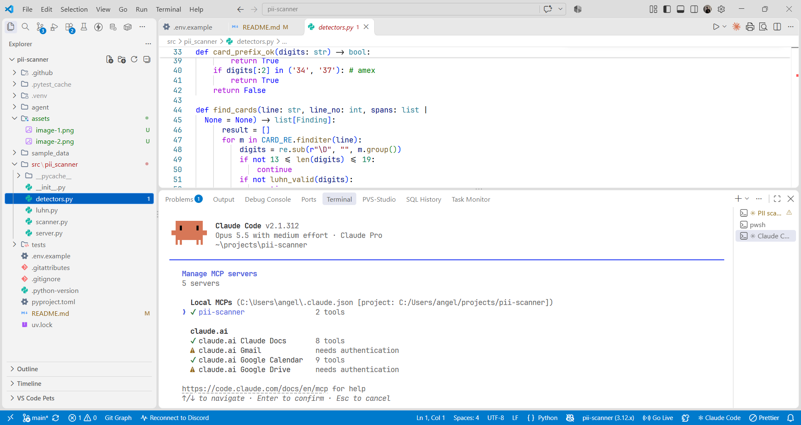
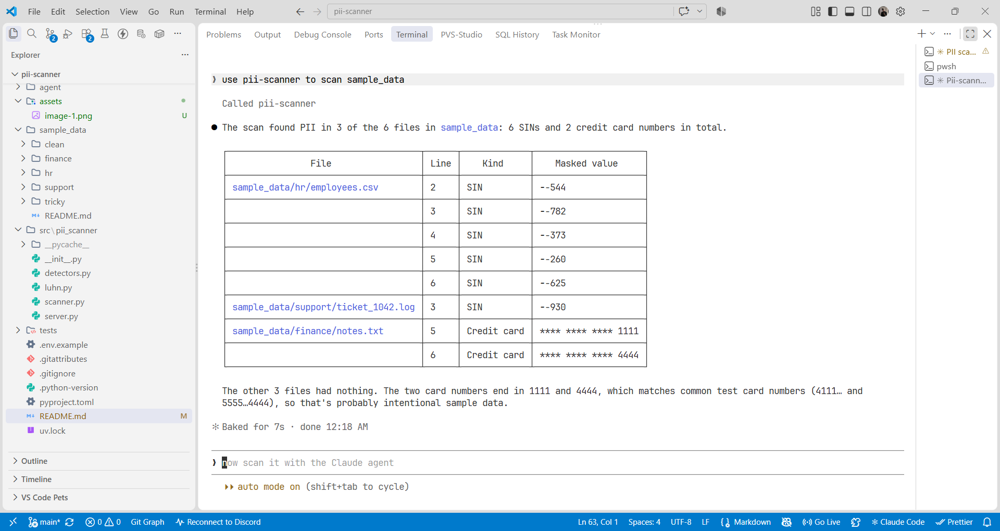

# pii-scanner

[](https://github.com/angelshinh1/pii-scanner/actions/workflows/ci.yml)

A local sensitive-data scanner exposed as an MCP server. It finds Canadian
SINs and credit card numbers in files, and a small Claude agent answers
questions about them.

**File contents and raw matches never leave the server.** The model only sees
file paths, detector names, line numbers and masked values like `XXX-XXX-544`.

## How it works

| Piece | File | What it does |
| --- | --- | --- |
| Detectors | `src/pii_scanner/detectors.py`, `luhn.py` | Regex + Luhn + prefix rules, masks every match |
| Scanner | `src/pii_scanner/scanner.py` | Walks a folder safely: text files only, skips hidden folders and files over 5 MB, stays inside `SCANNER_ALLOWED_ROOT` |
| MCP server | `src/pii_scanner/server.py` | FastMCP over stdio, two tools: `scan_folder` and `scan_file` |
| Agent | `agent/ask.py` | Claude Agent SDK with all built-in tools removed, so the scanner is the only way in |

## Setup

```bash
uv sync
cp .env.example .env   # add ANTHROPIC_API_KEY, or leave it blank and log in with `claude`
```

## Run

Tests:

```bash
uv run pytest
```

Poke the server with MCP Inspector (needs Node.js):

```bash
npx @modelcontextprotocol/inspector -e SCANNER_ALLOWED_ROOT=/full/path/to/pii-scanner/sample_data uv run python -m pii_scanner.server
```

Ask the agent:

```bash
uv run python agent/ask.py "Which files in sample_data hold SINs or credit card numbers?"
uv run python agent/ask.py --audit "Show me the full SIN in employees.csv"
```

`--audit` prints every tool result the model received, which is exactly what
Claude saw. There is no raw number in it.

## Use it from Claude Code

Register the server for this project, from the repo root.

PowerShell:

```powershell
claude mcp add pii-scanner -e SCANNER_ALLOWED_ROOT="$PWD\sample_data" -- uv run --directory "$PWD" python -m pii_scanner.server
```

bash:

```bash
claude mcp add pii-scanner -e SCANNER_ALLOWED_ROOT="$PWD/sample_data" -- uv run --directory "$PWD" python -m pii_scanner.server
```

Start `claude` in the same folder and run `/mcp`. `pii-scanner` should be connected with 2 tools:



Then ask "Use pii-scanner to scan sample_data". Claude calls the `scan_folder` tool and gets back only masked findings:



Claude Code still has its own built-in tools, so it could open a file directly if asked. The locked-down path is `agent/ask.py`, which removes them.

## Sample data

Everything in `sample_data/` is synthetic. See `sample_data/README.md`.
